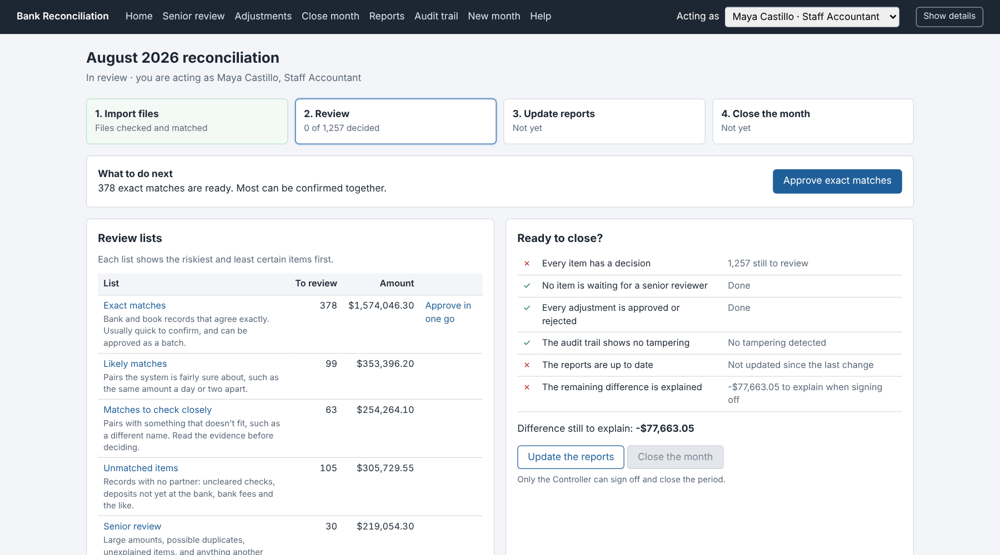
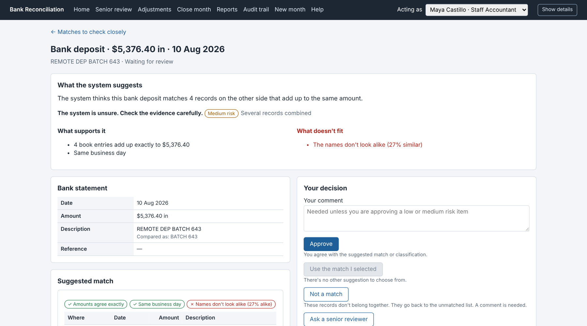
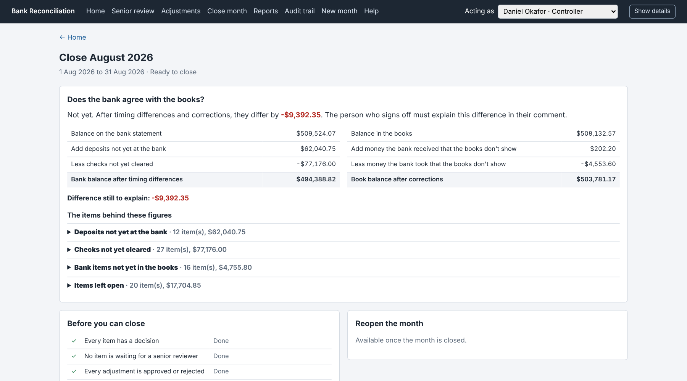

# User Guide — AI-Assisted Bank Reconciliation

## 1. What the System Does

Each month the system compares the bank statement with the company's books for the operating account, suggests how every record should be treated, and asks a person to confirm each suggestion. **Nothing is accepted automatically.** The system suggests, people decide, and every step is recorded in the audit trail.

A month goes through four steps, shown at the top of Home:

| Step | What happens | Who |
|-------------------|-------------------------------------------------------------------|-------------------------------|
| 1. Import files | Upload the bank statement, the books for the cash account and last month's open items. The files are checked, then matched | Staff or Senior Accountant |
| 2. Review | Confirm or correct every suggestion, explain records with no partner, send doubtful items to a senior reviewer | Staff and Senior Accountants |
| 3. Update reports | The reports confirm every approved item. Only then does an item count as reconciled | Anyone |
| 4. Close the month | Review the bank-to-book statement, explain any difference, sign off. The month is locked | Controller |

## 2. Getting Started

Open <http://127.0.0.1:8000> (see the Installation Guide, GDE-01, to start it). At the top right, choose who you are from **Acting as**. Everything you do is recorded under that name.

| Person | Role | Can |
|------------------|------------------------|--------------------------------------------------------------|
| Maya Castillo, Ethan Brooks | Staff Accountant | Import files, review items, approve exact matches in one go, propose adjustments, ask to reopen a month |
| Priya Raman | Senior Accountant | Everything a Staff Accountant can, plus decide senior-review items, approve adjustments and reverse a decision someone else made |
| Daniel Okafor | Controller | Decide senior-review items, approve adjustments, reverse a decision someone else made, sign off and close the month, decide reopening |

**Acting as is not a login.** It records who made each decision, and the system checks every action against that person's role.

The menu along the top:

| Menu | Opens |
|---------------|-------------------------------------------------------------|
| Home | Progress, what to do next, the review lists and the close checklist |
| Senior review | Items that need a Senior Accountant or the Controller |
| Adjustments | Proposed correcting entries and their approval |
| Close month | The bank-to-book statement, the close checklist, sign-off and reopening |
| Reports | The thirteen reports for the month |
| Audit trail | Every recorded action, with the tamper check |
| New month | Start a month and upload its files |
| Help | Short explanations of every list, choice and term |

**Show details** (top right) reveals the rule references, scores and record codes behind every screen. You do not need it for everyday work; auditors and administrators use it.

## 3. Home

{width=5.6in}

| Area | What it tells you |
|----------------|---------------------------------------------------------------------------|
| Four steps | Which step the month is in. The current step is outlined |
| What to do next | The most useful thing for **you** to do now, with a button. It changes with the person you are acting as |
| Review lists | How many items are waiting in each list and their total value |
| Ready to close? | The six conditions for closing, each ticked or crossed, with the difference still to explain |

## 4. Starting a Month

1. Act as a Staff or Senior Accountant and choose **New month**.
2. Enter the first and last day (for the sample data, 1 Aug 2026 and 31 Aug 2026) and choose **Start the month**.
3. Upload the files and choose **Upload the files**:

| File | Needed | Sample file |
|--------------------------------|----------|------------------------------|
| Bank statement | Yes | `bank_statement.csv` |
| Company books (cash account) | Yes | `gl_cash_detail.csv` |
| Open items from last month | Yes | `carry_in_items.csv` |
| Control totals | Optional | `run_control.csv` |

4. Choose **Check and match**. The system checks the files, tidies descriptions and references for comparison (the originals are kept), then matches bank and book records and sorts every record into a review list.

**Results of the file checks** shows what was found. If a file fails a check, nothing is matched: correct the file and start the month again. Rows that could not be read are listed under **Rows set aside**. Possible duplicates and dates outside the month are kept and listed under **Things to look at**, so reviewers see them.

## 5. The Review Lists

Every record lands in exactly one list. Each list shows the riskiest and least certain items first. **Nothing is hidden**, however unlikely the suggestion.

| List | What is in it | Usual action |
|----------------------------|---------------------------------------------------------------|------------------------------------|
| Exact matches | Bank and book records that agree exactly on amount, date and reference | Approve in one go |
| Likely matches | Pairs the system is fairly sure about, such as the same amount a day or two apart | Read and approve, or correct |
| Matches to check closely | Pairs with something that doesn't fit, such as a different name | Read the evidence before deciding |
| Unmatched items | Records with no partner: uncleared checks, deposits not yet at the bank, bank fees | Confirm what each one is |
| Senior review | Items of $10,000 or more, possible duplicates, unexplained items, and anything escalated | A Senior Accountant or the Controller decides |

### Approving exact matches in one go

On Home choose **Approve exact matches**. The page lists every exact match with low risk and its total. Untick anything you want to look at separately, then choose **Approve the ticked matches**. Each item is still recorded individually, under your name.

## 6. Reviewing an Item

{width=5.6in}

| Section | What it shows |
|------------------------------------|----------------------------------------------------------------|
| What the system suggests | The suggestion in one sentence, how sure the system is, and the risk level with its reason |
| What supports it / What doesn't fit | The evidence on both sides. Anything that doesn't fit is in red and never left out |
| Bank statement / Company books | The record itself; "Compared as" shows the tidied value used for matching |
| Suggested match / Possible matches | The record or records on the other side, with what agrees (✓) and what doesn't (✗) |
| Original records, exactly as received | Each record exactly as it arrived in its file, before any tidying. Use these to check against the source document |
| Your decision | The choices available to you, each with a short explanation, and your comment |
| What has happened so far | Every earlier decision on the item, with who and when |

**How sure the system is decides only the order you see items in, never the outcome.** A suggestion marked "unsure" can be right and one marked "fairly sure" can be wrong: read the evidence.

### Your choices

| Choice | Use it when | Comment needed |
|------------------------------|---------------------------------------------------------------|---------------------|
| Approve | You agree with the suggested match or classification | Only for high-risk items |
| Use the match I selected | Another possible match is the right one. Select it first, in the list on the left | Yes |
| Not a match | The records don't belong together. They go back to the unmatched list | Yes |
| Ask a senior reviewer | You are not sure, or the item needs more authority | Yes |
| Leave open for investigation | You can't explain it yet. It stays on the reconciliation statement | Yes |
| Match the ticked records | For a record with no partner: under **Find the matching records yourself**, tick the records that belong with it. They must add up to exactly the same amount | Yes |

Not every choice appears on every item. Possible duplicates and unexplained items cannot simply be approved: they are investigated, then left open or matched. After each decision the next item in the list opens.

### Proposing a correcting entry

For bank fees, interest and bank items missing from the books, the item page shows **Propose a correcting entry**, filled in from the kind of item. Check the amount and the debit and credit accounts, add the supporting document reference, and choose **Propose this entry**. Someone else must approve it on the **Adjustments** page. **This tool never posts an entry**: the accounting team records it in the books after approval.

### Optional AI summary

If AI summaries are switched on, the item page offers **Write a plain-words summary**. The summary only restates the evidence on the page and is marked **written by AI, not evidence**. It never scores, decides or approves anything, and the deterministic evidence is always shown beside it.

## 7. Senior Review and Adjustments

**Senior review** (Senior Accountant or Controller) holds high-risk items and everything a reviewer escalated, with who sent it and why. The same item page and choices apply.

**Adjustments** lists each proposed entry with its accounts, reason and who proposed it. A Senior Accountant or the Controller approves or rejects it; rejecting needs a comment.

### Correcting a decision

If a decision turns out to be wrong, a Senior Accountant or the Controller opens the item and uses **Correct this decision**: write why it was wrong and choose **Reverse this decision**. The decision stays on record, the reversal is recorded beside it, and the item goes back to its list to be decided again. This works while the month is open, for approvals and items left open. It is not available when an adjustment for the item is waiting or approved, and a "Not a match" decision needs no reversal: those records are already back in review.

Some steps always need a second person, so no one checks their own work. If a button is greyed out, the reason is written next to it:

| You cannot | Because |
|------------------------------------------------------|----------------------------------------------|
| Make the final decision on an item you reviewed or escalated | Someone else must decide it |
| Reverse a decision you made | Someone else must reverse it |
| Approve an adjustment you proposed | Someone else must approve it |
| Sign off a month in which you were the only reviewer | Someone else must sign off |
| Decide a reopening you asked for | Someone else must decide it |

A blocked attempt changes nothing and is noted in the audit trail.

## 8. Updating the Reports

When every item has a decision, choose **Update the reports** (on Home, Close month or Reports). This creates the thirteen reports and confirms each approved item against them: only then does the item count as **reconciled**. Update the reports again after any later change; the close checklist shows whether they are up to date.

Each report opens as a page (**Open**) and downloads as a spreadsheet (**Download CSV**). The Reconciliation Summary is the one to keep with the month-end file; earlier versions are kept on record.

## 9. Closing the Month

{width=5.6in}

Act as the Controller and choose **Close month**.

1. **Does the bank agree with the books?** answers in one line. Below it is the bank-to-book statement: the bank balance after timing differences on the left, the book balance after corrections on the right, and the difference still to explain.
2. Open any of the four sections (deposits not yet at the bank, checks not yet cleared, bank items not yet in the books, items left open) to see the items behind each figure.
3. **Before you can close** must be all ticks except the difference, which you explain in your comment.
4. Write your comment and choose **Sign off and close the month**. The month is locked: no decision, adjustment or import can change it.
5. Update the reports once more to keep a copy of the signed Reconciliation Summary.

On the sample month, a complete review closes with a difference of **-$9,392.35**, the amount the sample data was built to leave unexplained. The Controller explains it in the sign-off comment.

### Reopening a closed month

If something must change after closing, a Staff or Senior Accountant chooses **Ask to reopen** on Close month and gives the reason. The Controller (not the person who asked) chooses **Allow reopening** or **Keep it closed**. A reopened month is back in review and must be signed off again.

## 10. The Audit Trail

**Audit trail** lists everything people and the system did in the month, in order: when, who, what happened, which records and any comment. Use **Show** to filter by kind of entry. The top of the page says whether the trail is intact: "No tampering detected" means every entry still matches its fingerprint. Entries are never changed or removed; a correction is added as a new entry.

## 11. Good Practice

| Do | Why |
|-----------------------------------------------------------|-------------------------------------------------------|
| Read "What doesn't fit" before approving | The system shows conflicting evidence precisely so you weigh it |
| Ask a senior reviewer when unsure | It costs one comment; a wrong approval costs a correction later |
| Write comments the next person can act on | "Remittance shows invoices 8812 and 8815" beats "checked" |
| Check original records against the source document | They are exactly what the bank and the books said |
| Update the reports after every round of decisions | Items count as reconciled only after the report check |

For questions and problems, see the FAQ and Troubleshooting guide (GDE-04).
