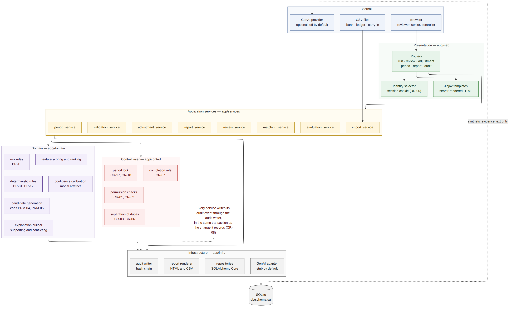

# Developer Guide — AI-Assisted Bank Reconciliation

## 1. Purpose

How the code is organized, the rules every change must keep, and the steps for the changes most likely to be needed. The reasons behind each design choice are in the System Design (DOC-05, ADR-01..31); requirement, rule and test IDs are defined in DOC-02 and DOC-06. Read section 4 before changing anything.

## 2. Development Setup

Follow the Installation Guide (GDE-01) sections 3 and 4, then:

| Task | Command |
|-------------------------------|------------------------------------------------------|
| Run every test | `python3 -m pytest -q` |
| Run one file | `python3 -m pytest -q tests/test_review.py` |
| Run tests by name | `python3 -m pytest -q -k manual_match` |
| Start the interface | `python3 -m app.cli serve` (restart after code changes) |
| Fresh database | `python3 -m app.cli reset --force` then `python3 -m app.cli init` |
| Inspect a run | `python3 -m app.cli status` and `python3 -m app.cli verify` |

Tests never touch `reconciliation.db`: each builds its own database in a temporary folder.

## 3. Codebase Map

{width=5.6in}

| Layer | Package | Holds | May import |
|----------------|------------------|-----------------------------------------------------------|----------------------------|
| Presentation | `app/web` | Routes (`routes/`), view functions (`views.py`), templates, wording (`labels.py`, `plain.py`) | services, control, labels |
| Services | `app/services` | One service per workflow; owns every transaction; `container.py` wires them | control, domain, infra |
| Control | `app/control` | Permissions, separation of duties, state models, period lock, the six-condition reconciliation rule, error codes | domain |
| Domain | `app/domain` | Rules, candidates, features, scoring, calibration, risk, exceptions, explanations, statement arithmetic. **No input or output** | nothing outside domain |
| Infrastructure | `app/infra` | Database, repositories (all SQL), audit chain, report rendering, AI summary adapters | domain |
| Storage | `db/schema.sql` | Tables, constraints, append-only and period-lock triggers, indexes | — |

Key files:

| File | What it does |
|--------------------------------------|----------------------------------------------------------|
| `app/cli.py` | Command line entry point |
| `app/config.py` | Loads `config/default.toml` and `config/local.toml`; the per-run parameter snapshot |
| `app/infra/db.py` | Connections and `transaction()` (BEGIN IMMEDIATE, rollback on any error) |
| `app/infra/audit.py` | `AuditLog.write` appends one hash-chained event; `verify` recomputes the chain |
| `app/infra/repositories.py` | Every SQL statement, grouped by table |
| `app/services/matching_service.py` | Rules, then candidates and scoring, then risk and routing |
| `app/services/review_service.py` | Every reviewer decision, batches and hand pairing |
| `app/services/period_service.py` | Readiness, sign-off, lock, reopening |
| `app/services/report_builders.py` | One builder per report |
| `app/services/evaluation_service.py` | The only code that reads ground truth |
| `app/web/views.py` | What each screen shows, built without a server |

## 4. Rules Every Change Must Keep

| Rule | Why | Where it is enforced |
|------------------------------------------------------------|--------------------------------------------|------------------------------------|
| Every state change writes an audit event in the **same transaction** | An action without evidence must be impossible (CR-08) | `AuditLog.write` takes the caller's connection |
| Checks that guard a write run on the **caller's connection**, inside the transaction | The check must see exactly the state the write changes | Services pass `connection` to control functions and repository reads |
| Audit and decision tables are append-only; a correction is a **new** row | Evidence is never edited (CR-09) | Database triggers, and no UPDATE/DELETE in repositories |
| A refused action raises `ControlViolation(rule, message)` and records a `BLOCKED_ATTEMPT` | Refusals leave evidence (ADR-12) | `services/blocked.record_blocked` |
| Nothing is approved because of confidence | Every item needs a human decision (CR-01) | No code path approves without a decision row |
| Money is integer cents; dates are ISO 8601; timestamps UTC | No rounding drift; stable sorting | Schema CHECK constraints, domain types |
| Rules use business dates, never processing time | Same data, same results on every run | Domain functions take dates as input |
| Parameters come from the run's snapshot, not the config file | A closed month never changes (ADR-10) | `parameter_snapshot` on `reconciliation_run` |
| Ground truth is read only by the evaluator, tests and benchmarks | The system cannot learn the answers | Only `evaluation_service.py` and `scripts/` open `ground_truth.csv` |
| Originals are kept beside normalized values | Reviewers and auditors see what arrived | `*_original` and `*_normalized` columns |
| No journal entry is ever posted | The system proposes; accounting posts | Adjustments end at approved |
| Screens show plain words; codes go behind **Show details** | Reviewers act on meaning, auditors still see codes | `labels.py`, `plain.py`, `class="tech"`; tests TC-I-080, TC-I-082 |
| `db/schema.sql` is the source of truth | One definition of the data | Repositories write explicit SQL against it |

## 5. How a Decision Flows

An approval from the item screen, end to end:

| Step | Code | What happens |
|------|---------------------------------------|----------------------------------------------------------------|
| 1 | `web/routes/review.py` | Reads the form and the person acting; calls the service |
| 2 | `ReviewService.decide` | Opens `database.transaction()` |
| 3 | `control/permissions.py`, `duties.py`, `period_lock.py` | Role, separation of duties, offered actions, comment rule and period lock, all on the transaction's connection |
| 4 | `repositories.py` | Writes the `review_decision` row and the status changes |
| 5 | `AuditLog.write` | Appends the DECISION event with the new chain hash |
| 6 | `db.transaction` | Commits; on any exception rolls back steps 4 and 5 together |
| 7 | On `ControlViolation` | `record_blocked` writes a BLOCKED_ATTEMPT event in its own transaction; the route shows the plain reason |

## 6. Common Changes

| Change | Steps |
|----------------------------|-----------------------------------------------------------------------------|
| Change a threshold | Edit `config/default.toml` and its dataclass in `app/config.py`; update the PRM entry in DOC-02. Existing runs keep their snapshot |
| Add a matching rule | Pure function in `domain/rules.py`, called from `apply_rules`; a new exception kind goes in `domain/exceptions.py`, with its plain name in `web/labels.py` (EXCEPTION_NAMES, EXCEPTION_HELP) and `infra/genai/base.py` (EXCEPTION_WORDS); TC-U-173 checks the two lists agree. Add unit and scenario tests |
| Add a control | Function in `control/` raising `ControlViolation`; register the rule in `control/errors.py` (ERROR_CODES) and its plain sentence in `labels.RULE_TEXT`; call it inside the service transaction; test the refusal and its BLOCKED_ATTEMPT event |
| Add a report | Builder in `services/report_builders.py`, registered in `BUILDERS`; title in `views.REPORT_TITLES`, description in `labels.REPORT_DESCRIPTIONS` |
| Add a screen | View function in `web/views.py`, template in `web/templates/`, route in `web/routes/`; a render test in `test_web_views.py` and an HTTP test in `test_web_routes.py` |
| Change wording | `web/labels.py` (fixed words) or `web/plain.py` (sentences built from data); keep codes in `class="tech"` elements |
| Add an AI summary provider | Subclass `GenAIAdapter` and implement `_generate` only; register it in `build_adapter`. The base class applies the decision-language guard, word limit and fallback |
| Regenerate data | `python3 scripts/generate_dataset.py` (add `--profile calibration` for July); refit with `python3 scripts/fit_calibration.py` |
| Change the schema | Edit `db/schema.sql`, update repositories and DOC-04; reset local databases. There is no migration tool by design (see `requirements.txt`) |

## 7. Tests

| Family | ID | Covers | Main files |
|------------------|----------|---------------------------------------------------------|-----------------------------------------------|
| Unit | TC-U-nnn | Domain and control functions on fixed inputs | `test_domain.py`, `test_scoring.py`, `test_control.py` |
| Integration | TC-I-nnn | Services on a real database, screens, routes, evaluator | `test_review.py`, `test_web_views.py`, `test_web_routes.py` |
| Control | TC-C-nnn | Each control rule: the refusal, the rule named, the evidence | `test_controls.py`, `test_period.py` |
| Hybrid | TC-H-nnn | What scoring adds, and must never do | `test_pipeline.py` |
| Scenario | TC-S-nnn | SCN-01..08 and the complete August month | `test_pipeline.py`, `test_reports.py`, `test_manual_match.py` |
| Reproducibility | TC-R-nnn | Same seed, same results; frozen parameters | `test_pipeline.py`, `test_evaluation.py` |

Name each test `test_<family>_<number>_<what it proves>`, using the next free number in that family; IDs are never reused. Shared fixtures are in `tests/conftest.py` and `tests/web_support.py` (`build_services` gives a matched August run on a fresh database). Every rule in DOC-02 maps to at least one test in DOC-06 section 5; keep that table current when adding a rule.

## 8. Working Conventions

| Topic | Convention |
|------------------|--------------------------------------------------------------------------------|
| Branches | One branch per piece of work, from `main`; squash-merge by pull request |
| Commits | Conventional Commits: `feat(web): ...`, `fix(review): ...`, `docs: ...`, `test: ...` |
| Never commit | `.env`, `config/local.toml`, `reconciliation.db*`, `reports/run_*` (all in `.gitignore`) |
| Documents | Every document in Markdown (`docs/markdown`, `guides/markdown`) and Word (`docs/word-files`, `guides/word-files`); diagrams as Mermaid source plus PNG in `docs/diagrams` |
| IDs | Requirement, rule, scenario and test IDs are stable across code, tests and documents |
| Not built on purpose | Anything deliberately left out is listed with its reason (DOC-05, DOC-06 section 10) |

Questions about behaviour are answered in the FAQ and Troubleshooting guide (GDE-04).
